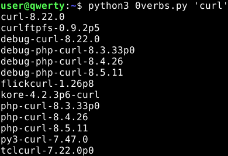

### 0verbs

Download (local .txt database) and search for OpenBSD package. No need to use the package searching (or set `PKG_PATH`) as it takes too long to list and find your query and you are required to have internet up and running.

Download this fellow and run it without any arguments, so it can download small `.txt` database first:

```bash
python 0verbs.py

# to query the database
python 0verbs.py 'curl'

# or use the slow option
pkg_info -aQ 'curl'
```

---

### Trying it from Linux/other BSD

Replace the following with:

```diff
diff --git a/0verbs.py b/0verbs.py
index fea5045..0050861 100644
--- a/0verbs.py
+++ b/0verbs.py
@@ -33,7 +33,7 @@ class PackageFinder(object):

         if not os.path.isfile(the_list):
             ftp_url = 'http://ftp.openbsd.org/pub/OpenBSD/{release}/packages/{arch}/SHA256'\
-            .format(release=self.spawN('uname', '-r'), arch=self.spawN('machine', '-a'))
+            .format(release='8.0', arch='amd64')

             print('Creating a small local database from all {0} packages'\
             .format(ftp_url))
```